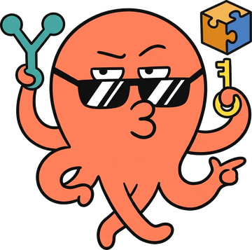
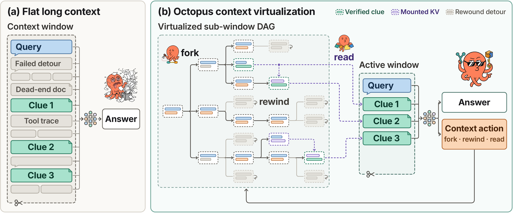
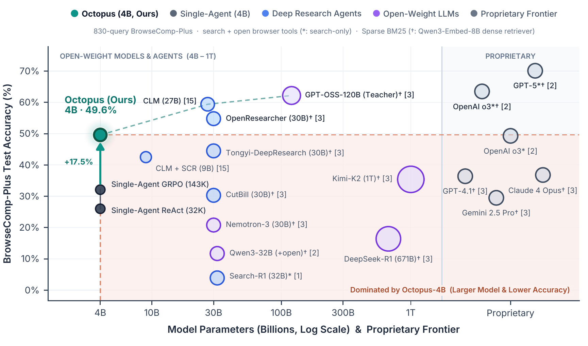
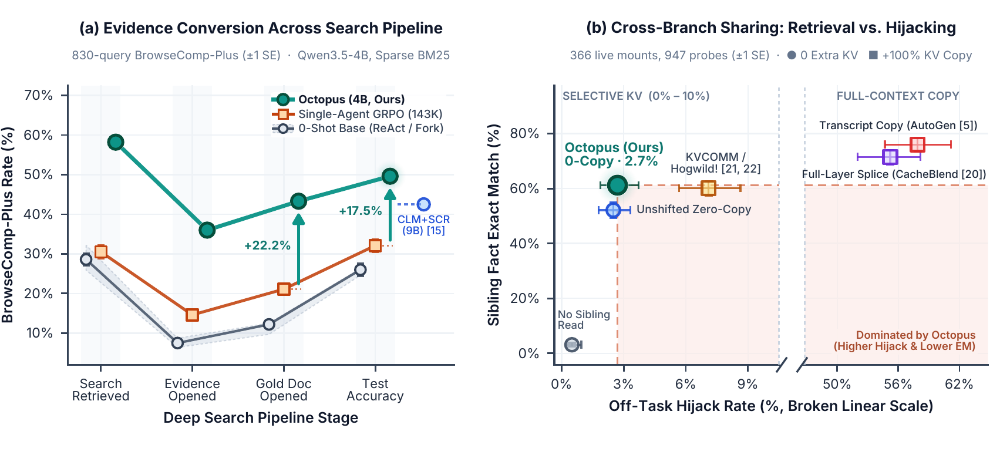
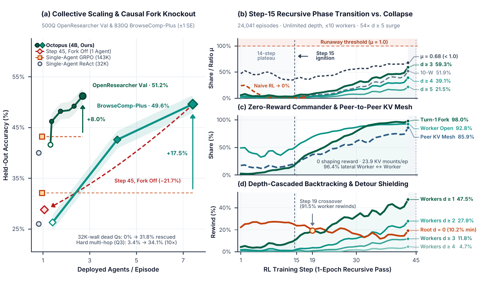

<div align="center">

<h1>
  
  &nbsp;Octopus: One Brain, Many Branches for Latent-KV Multi-Agent Reinforcement Learning
</h1>

<p><b>GPU-Resident Execution DAGs via Zero-Copy Forking and Hijack-Free Cross-Branch KV Mounting</b></p>

<p>
  <b>Tianming Sha</b><sup>1</sup> &nbsp;·&nbsp;
  <b>Junnan Li</b><sup>2</sup> &nbsp;·&nbsp;
  <b>Siqi Zhao</b><sup>3</sup>
  <br/>
  <sup>1</sup>Stony Brook University &nbsp;&nbsp;
  <sup>2</sup>University of Wisconsin–Madison &nbsp;&nbsp;
  <sup>3</sup>University of Minnesota
</p>

<p>
  <a href="https://shatianming5.github.io/octopus/"></a>
  <a href="paper/Octopus.pdf"></a>
  <a href="https://huggingface.co/datasets/Tommysha/octopus-train"></a>
  <a href="#supported-architectures"></a>
  <a href="#quickstart"></a>
</p>

</div>

---

<p align="center">
  
</p>

**Octopus** is a co-designed serving runtime, GPU memory manager, and reinforcement learning (RL) framework that replaces flat, append-only agent transcripts with a **stateful, GPU-resident execution DAG**. Instead of cramming parallel hypotheses and dead-end detours into one linear context window—or relying on stateless client-side multi-agent harnesses that duplicate shared prefixes and hijack recurrent states—Octopus executes episodes over immutable radix KV cursors via five primitives (`fork`, `rewind`, `read_thread`, `wait`, and `done`) and trains policies end-to-end with **1D Packed `DAG-GRPO`**.

---

## Key Highlights

- **GPU-Resident Execution DAG (`89.6%` Live GPU KV Hit Rate):** Branches fork in $\mathcal{O}(1)$ zero copy with isolated `32K` context budgets and backtrack via exact hybrid recurrent checkpoint restoration—reusing **89.59%** of prompt tokens directly on GPU across `447,993` H200 prefill batches, cutting wire traffic by **98.3%** (`662.3 → 11.5 MB`), and accelerating `128K` prompt assembly by **249×** (`358.5 → 1.44 ms`).
- **Hijack-Free Cross-Branch KV Mounting (`92.2%` Info Retention, `21×` Lower Hijacking):** To share findings across branches without overwriting recurrent working memory (`GDN` / `Mamba-2`), `read_thread` splices sibling KV pages in zero copy **exclusively into full-attention layers** under monotonic position offsets ($s(c'_B) = \max(p_B, e_A + 1)$) while recurrent layers skip mounted spans—retaining **92.2%** answer information and cutting off-task hijacking from **57.9%** to **2.7%** with **0 extra KV pages**.
- **Differentiable 1D Packed `DAG-GRPO` (`32×` Lower KL, `8.1×` Avg / `11.1×` Peak Token Scaling):** Deduplicates shared prefixes into a single 1D token stream via single-ownership masking while keeping mounted KV edges live in the forward–backward graph, holding rollout–training divergence at $\mathrm{KL}(\pi_{\text{rollout}} \parallel \pi_\theta) = 4.45 \times 10^{-4}$ (vs. `0.0142` without mounts) and routing reader policy gradients directly into producer KV projections.
- **Emergent Commander–Mesh Hierarchy & `4B` Frontier Dominance:** Trained on **Qwen3.5-4B** under **pure binary `0/1` outcome rewards** and **sparse BM25** (zero process shaping), Octopus undergoes a Step-15 phase transition into a sub-critical recursive hierarchy ($\mu < 1$) and lateral peer-to-peer KV mesh—reaching **49.6%** on **BrowseComp-Plus** (**+17.5 pts** over `143K` single-agent GRPO; **−21.7 pts** when test-time `fork` is disabled on the same weights) and **51.2%** on **OpenResearcher**, outperforming dense-retriever systems up to **250×** larger.

---

## Main Results

### 1. Parameter–Accuracy Frontier on BrowseComp-Plus (`830` Queries)

<p align="center">
  
</p>

| System / Policy | Params | Retriever & Tools | Explored / Crit. Path | Gold Doc Open | OpenResearcher Val | BrowseComp-Plus |
| :--- | :---: | :---: | :---: | :---: | :---: | :---: |
| Single-Agent ReAct (`32K` Window) | `4B` | BM25 (`search+open`) | `32.6K` / `1,043` | `12.2%` | `40.0%` | `26.0%` |
| Single-Agent GRPO (`143K` Flat Window) | `4B` | BM25 (`search+open`) | `40.8K` / `4,075` | `21.1%` | `43.2%` | `32.1%` |
| Multi-Agent Fork (0-Shot Untrained) | `4B` | BM25 (`search+open`) | `33.2K` / `1,073` | `12.5%` | `41.6%` | `26.3%` |
| CLM + SCR (In-Place Context Editing RL) | `9B` | BM25 (`search+open`) | Multi-edit (`≤32K`) | — | — | `42.5%` |
| Tongyi-DeepResearch | `30B` | Dense (`Qwen3-Embed-8B`) | Flat Window | — | — | `44.5%` |
| DeepSeek-R1 / Kimi-K2 | `671B` / `1T` | Dense (`Qwen3-Embed-8B`) | Flat Window | — | — | `16.4%` / `35.4%` |
| GPT-4.1 / Claude 4 Opus | Proprietary | Dense (`Qwen3-Embed-8B`) | Flat Window | — | — | `36.4%` / `36.8%` |
| **Octopus (`D_max = 1`, Parallel Team)** | **`4B`** | **BM25 (`search+open`)** | **`128.0K` / `6,421`** | **`34.8%`** | **`51.2%`** | **`42.6%` (+10.5)** |
| **Octopus (`D_max = ∞`, Recursive DAG)** | **`4B`** | **BM25 (`search+open`)** | **`329.2K` / `9,919`** | **`43.3%`** | **`46.5%`** *(W≤1)* | **`49.6%` (+17.5)** |

### 2. Context Conversion Efficiency & Hijack-Free Cross-Branch KV Mounting

<p align="center">
  
</p>

### 3. Multi-Agent Collective Scaling & Emergent Step-15 Phase Transition

<p align="center">
  
</p>

---

## Execution Primitives & Supported Architectures

### Five Cursor-Level Execution Primitives

| Primitive | Signature | GPU Radix KV & Hybrid Recurrent (`h_t`) Semantics |
| :--- | :--- | :--- |
| **`fork`** | `fork({b_1: g_1, ...})` | Increments parent radix KV page ref-counts in $\mathcal{O}(1)$ (`0` new pages), clones hybrid recurrent state $\mathbf{h}_{\text{end}}(c)$, and grants each child a fresh `32K` token budget. |
| **`rewind`** | `rewind(k, note)` | Resets active cursor to step-$k$ checkpoint $c_k$, restores exact pre-detour recurrent state $\mathbf{h}_{\text{end}}(c_k)$, and injects a concise pivot note while keeping pruned leaves in the RL credit graph. |
| **`read_thread`** | `read_thread(A, [s, e])` | Zero-copy mounts sibling $A$'s KV pages $c_A[s:e)$ into full-attention layers $\mathcal{L}_{\text{mount}}$ under monotonic position offsets $s(c'_B) = \max(p_B, e_A + 1)$; recurrent layers $\mathcal{L}_{\text{rec}}$ skip the mounted span. |
| **`wait`** | `wait([b_1, ...])` | Suspends caller decoding at zero active compute while retaining its GPU cursor handle, resuming with compact child return payloads upon completion. |
| **`done`** | `done(summary)` | Closes the active branch (or concludes the episode at the root) and freezes its radix cursor into an immutable, mountable snapshot. |

### Supported Architectures

Octopus integrates dense, sparse-MoE, and hybrid recurrent-attention families across both SGLang serving and 1D packed `DAG-GRPO` training via a declarative hook registry (`octopus/rl/model_hooks.py`, `lora_targets.py`, `seq_tiles.py`):

| Model Family | Layer Topology | Serving KV Mount & State Hook | 1D Prefix-Tree Training & LoRA Hook |
| :--- | :--- | :--- | :--- |
| **`Qwen3` / `Llama-3` (Dense)** | $L$ Full-Attn + SwiGLU ($\mathcal{L}_{\text{rec}} = \emptyset$) | Middle-layer sparse mount (`OCTOPUS_MOUNT_LAYERS`, e.g., `9/36` layers, `96.9%` argmax agreement) | `CONV_CONTEXT = 0`; split mounted vs. unmounted varlen FlashAttention passes |
| **`Qwen3-MoE`** | $L$ Full-Attn + Top-$K$ MoE ($K=8$) | Attention-only Radix KV mount; `0` expert state copy on `fork`/`rewind` | 1D deduplicated tree tokens batched into a single grouped MoE GEMM |
| **`Qwen3.5` (Dense & MoE)** | `24` Gated DeltaNet + `8` Gated Full-Attn | All `8` Full-Attn layers 0-copy mount; `24` GDN layers clone/restore $\mathbf{h}_k$ & skip mounts | `CONV_CONTEXT = 3` (`tree_conv`) + `fla` `chunk_gated_delta_rule` + `16K` activation tiling + fused `in_proj_qkvz` LoRA |
| **`Granite-4.0-H`** | Mamba-2 SSD + GQA Full-Attn + MoE | Transitive $X \leadsto A \leadsto C$ Attn KV mount (`98.5%` agreement); Mamba-2 state skips mounts | `CONV_CONTEXT = d_conv - 1`; Mamba-2 SSD mapped to `fla` `chunk_simple_gla` + patched Mamba `out_proj` LoRA |

---

## Repository Architecture

```text
octopus/
  runtime/       Fork-tree execution runtime (tree.py: CursorRuntime), single-thread loop (core.py), OCTOPUS_* settings
  serving/       Server-resident cursor protocol (delta_render, cursor_store, cursor_audit) & attention-only KV mount (kv_mount)
  rl/            1D Packed DAG-GRPO trainer on AReaL: workflow / group (R = 2y - 1), prefix_tree actor, model_hooks, LoRA, proxy
  envs/search/   Offline deep-search environment (OpenResearcher training & BrowseComp-Plus evaluation, BM25 / reader service)
  envs/swe/      Containerized multi-task SWE environment on Harbor (udocker / Singularity, coupled task bundles)
  eval/          Evaluation harnesses: search_dev_eval (Validation & BrowseComp-Plus), bcp, dev_eval (SWE)
  tools/         Counterfactual probes & diagnostics (kv_read_probe, mount_check, tree_check)
scripts/         Deployment (deploy.sh, check_env.sh), RL launchers (rl_env/), evaluation runners (eval/), architecture checks
patches/         SGLang 0.5.19 & AReaL overlays for server-resident cursors, zero-copy KV mounting, and online LoRA updates
baselines/       External KV-sharing & multi-agent baseline reproductions (Route A cross-architecture KV-mount probes)
tests/           Unit & GPU integration test suites (pytest)
docs/            Detailed protocol specifications and systems design documents
paper/           Technical report: PDF (Octopus.pdf) and its Overleaf LaTeX source (main.tex, figures/, scripts/)
results/         Experiment records and reports, one directory per run (index: results/README.md)
data/            Small dataset splits and manifests (search split, SWE task bundles)
assets/          Figures used in this README
```

Module imports enforce a strict acyclic layering (`runtime / serving ← rl ← envs ← eval ← tools`, with `envs.swe` and `envs.search` mutually isolated), verified automatically via `python scripts/import_graph.py`.

---

## Quickstart

### 1. Environment Setup & Automated Deployment

Pre-packaged environments, SGLang/AReaL cursor-mount overlays, Harbor task bundles, and pre-built BM25 indices (`OpenResearcher` + `BrowseComp-Plus`) are hosted on HuggingFace at [`Tommysha/octopus-train`](https://huggingface.co/datasets/Tommysha/octopus-train) (`code` branch: ~330 MB; `search` branch: ~57 GB).

**Prerequisites:** Linux `x86_64` (or `aarch64` GB200 via `scripts/beta/install_env.sh`), NVIDIA driver supporting CUDA 12.9, `git`, `curl`, `patch`, `gcc`, and `fusermount3` (`/dev/fuse`; root/Docker not required).

```bash
git clone https://github.com/shatianming5/octopus.git && cd octopus

# 1) Fetch codebase snapshot and datasets (--search also pulls the 57 GB BM25 search corpus & training queries)
bash scripts/deploy.sh $ROOT fetch --search

# 2) Build Python virtual environments, download Qwen3.5-4B, and apply SGLang + AReaL cursor/mount overlays
bash scripts/deploy.sh $ROOT install

# 3) Verify overlays, model checksums, dependency graph, and live serving/search health
bash scripts/deploy.sh $ROOT check --gpu 0
```

For lightweight local development and CPU unit testing without a full cluster setup:

```bash
uv sync --python 3.12 --extra tiny-lora --extra test
pytest -m "not gpu"
python scripts/import_graph.py
python scripts/check_agent_equivalence.py
```

### 2. Launching the BM25 Search & Reader Service

```bash
source $ROOT/harbor/scripts/env.sh

# Serve the OpenResearcher / BrowseComp-Plus BM25 index + 8K paginated document reader
$ROOT/areal/.venv/bin/python -m octopus.envs.search.service serve \
  --corpus browsecomp-plus \
  --root $ROOT/search-data \
  --backend bm25 \
  --port 8000 \
  --workers 8
```

### 3. Training with 1D Packed `DAG-GRPO`

```bash
source $ROOT/harbor/scripts/env.sh

# Launch SGLang cursor/mount rollout servers + AReaL 1D prefix-tree DAG-GRPO trainer
RL_ENV_FILE=scripts/rl_env/rl_run.search.env scripts/rl_env/rl_run.sh start search-run

# Check live training & KV-pool admission status, or stop cleanly
RL_ENV_FILE=scripts/rl_env/rl_run.search.env scripts/rl_env/rl_run.sh status search-run
```

### 4. Evaluating Branching Agents

```bash
# Start SGLang evaluation servers with trained LoRA adapter(s)
scripts/rl_env/eval_serve.sh start 0,1,2,3 rq1-v45=/path/to/adapter

# Evaluate on BrowseComp-Plus (830 queries) or OpenResearcher Validation (500 queries)
OCTOPUS_SEARCH_URL=http://127.0.0.1:8000 \
  python -m octopus.eval.search_dev_eval \
  --set browsecomp-plus \
  --servers http://127.0.0.1:30000,http://127.0.0.1:30001,http://127.0.0.1:30002,http://127.0.0.1:30003 \
  --lora rq1-v45 \
  --out outputs/bcp_rq1_v45.jsonl \
  --run /path/to/run_log_dir
```

---

## Documentation

| Document | Scope |
| :--- | :--- |
| **[`paper/Octopus.pdf`](paper/Octopus.pdf)** | Full technical report (*Octopus: One Brain, Many Branches for Latent-KV Multi-Agent Reinforcement Learning*); LaTeX source in `paper/` (`main.tex`, `figures/`, figure scripts in `scripts/`) |
| [`docs/cursor-protocol.md`](docs/cursor-protocol.md) | Server-resident cursor protocol, cross-family chat-template delta probing, SGLang/AReaL patches, and KV mounting |
| [`docs/cross-branch-read.md`](docs/cross-branch-read.md) | `read_thread` runtime execution and differentiable 1D prefix-tree + mounted-KV forward/backward pass |
| [`docs/rl-plan-episodes.md`](docs/rl-plan-episodes.md) | Tree/DAG episode RL dataflow, outcome rewards ($R = 2y - 1$), fork/close contracts, and `rewind` credit |
| [`docs/search-env.md`](docs/search-env.md) | Deep-search environment protocol, BrowseComp-Plus parity, and KV-aware episode admission (`OCTOPUS_ROUTE_KV`) |
| [`docs/trainer-memory.md`](docs/trainer-memory.md) | 1D prefix-tree memory layout, `16K` sequence tiling, pinned-host activation slabs, and `chunk_major` FSDP2 execution |
| [`docs/kv-read-probe.md`](docs/kv-read-probe.md) | Counterfactual probe suite comparing attention-only monotonic KV mounting against text copy, full splice, and RoPE relocation |
| [`docs/search-read-hijack.md`](docs/search-read-hijack.md) | Live blind-judge off-task hijacking audit and counterfactual SGLang mount diagnostics |
| [`docs/ablations.md`](docs/ablations.md) | Tree width ($W_{\max}$) and recursive depth ($D_{\max}$) scaling ablations |
| [`docs/task-bundles.md`](docs/task-bundles.md) | Coupled SWE task bundles and CooperBench multi-agent feature-pair construction |
| [`docs/dev-notes-zh.md`](docs/dev-notes-zh.md) | Archived internal engineering notes & historical run logs (Chinese) |

---

## Citation

If you find Octopus useful in your research or agent systems, please cite our technical report:

```bibtex
@article{sha2026octopus,
  title   = {Octopus: One Brain, Many Branches for Latent-KV Multi-Agent Reinforcement Learning},
  author  = {Sha, Tianming and Li, Junnan and Zhao, Siqi},
  year    = {2026},
  note    = {Technical Report}
}
```

## License

Apache License 2.0; see [`LICENSE`](LICENSE). The SGLang and AReaL overlays in `patches/` modify Apache-2.0 projects and keep their terms.
