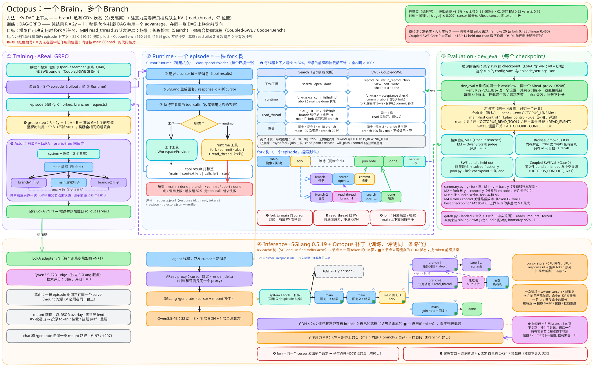
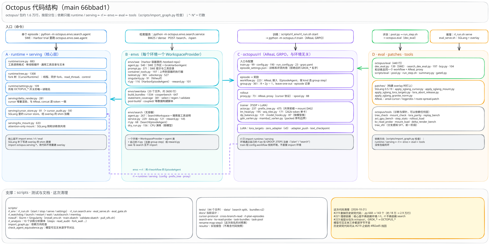

# Octopus（工程与阶段记录归档）

> 说明：本文档归档了早期工程设计与阶段训练记录；完整定稿实验结果、部署指南与技术报告请见仓库主页 [README.md](../README.md) 与 [paper/Octopus.pdf](../paper/Octopus.pdf)。

**One Brain, Many Branches.**

Octopus 是一个让模型自己分叉的 agent runtime 和对应的 RL 训练：

- **Runtime。** 一个 episode 是一棵 fork 树：main 线程调用 `fork` 分出 branch，branch 以 `commit` / `abort`（或 `done`；search 只有 `done`）收尾，main 只拿回结果；可选的 `rewind`（`OCTOPUS_REWIND_TOOL`，默认关；搜索的训练配置 `scripts/alpha/search.env` 打开，只回退历史）让线程回到自己更早的某一步重来；`fork` 成功启动的那条回复不能同时 `rewind` 或收尾（会被拒绝，不计调用数）。线程之间可以 `read_thread`：把另一个线程一段 token 的 KV 挂载（mount）进自己的注意力层（默认全部注意力层，`OCTOPUS_MOUNT_LAYERS` 可指定子集），GDN / Mamba-2 这类递归层不看它；位置按 K2 规则（从 max(下一位置, 挂载末位 + 1) 继续）。
- **RL。** 纯结果奖励 R = 2y − 1（y = 最终结果：搜索是答案对错，SWE bundle 是解决的任务比例），leave-one-out 得到 advantage，默认（`rl.branch_credit=outcome`）整棵 fork 树共用一个；`gate` 按环境各自的规则：SWE 下 ok 的分支取 max(A_main, 0)、其余取 min(A_main, 0)，搜索下 ok 的分支取 A_main、其余取 min(A_main, 0)（`octopus/rl/group.py` `code_gate` / `search_gate`；旧值 `search_gate` 已去掉，报错），R 不变；训练用 prefix tree 前反向，共享前缀只算一次，mount 是树上额外的注意力边（DAG）。
- **两个环境。** 离线搜索（OpenResearcher 训练、BrowseComp-Plus 评测）；SWE bundle（Harbor 容器里一个 repo 上的多个任务）。同文件耦合 bundle 的构建规则在 [docs/task-bundles.md](task-bundles.md) 的 Same-file coupled bundles 和 [octopus/envs/swe/data/coupled/README.md](../octopus/envs/swe/data/coupled/README.md)；CooperBench v2 的构建和验收在同一篇的 CooperBench feature pairs (`cooperbench-v2`)。

## 现状

已核实的是机制，不是收益：

| 项 | 结果 | 出处 |
|---|---|---|
| attention-only mount 能取回，劫持增量小 | Qwen3.5-4B，366 个真实 mount 点：K2 取回 EM 0.627（base）/ 0.612（e11 adapter），文本读入 0.760，不读 0.03；劫持比不读多 0.036（base，CI [0.019, 0.057]，上界超过 0.05，预注册判定为 mixed）/ 0.022（e11，supported），文本和 replay 读入劫持 55–58% | [docs/kv-read-probe.md](kv-read-probe.md) Run 2 |
| 训练 = 推理（prefix tree + mount） | actor 的 micro-batch tree forward 对 SGLang rollout logprob：读过的 token mean \|Δ logprob\| 0.0038（98 token），去掉 mount 是 0.0142 | [docs/cross-branch-read.md](cross-branch-read.md) `test_live_read_trains_as_it_rolled_out` |
| mount 不限于 Qwen3.5 | 推理端对 transformers 逐 token 对照：Qwen3.5-4B（GDN 混合）、Qwen3-4B-Base（纯注意力，含只挂每第 4 层）、granite-4.0-h-350m（Mamba-2 混合）；训练端按模型家族注册递归层钩子（`octopus/rl/model_hooks.py`：GDN、Mamba-2；无递归层的未注册家族按纯注意力，有递归层的未注册家族报错）；训练前向对照过 Qwen3.5-4B（GDN）和 Qwen3-4B-Base（纯注意力，含每第 4 层子集），Mamba-2 训练端只注册了钩子，前向未对照。RL 实验目前只用 Qwen3.5-4B | [docs/cursor-protocol.md](cursor-protocol.md) Mount 的 live 结果，`tests/test_sglang_mount.py` |
| cursor 增量无损 | 与 AReaL concat oracle 逐 token 比较：7,643 个 cursor 请求 0 mismatch | [docs/cursor-protocol.md](cursor-protocol.md) Live acceptance |

**阶段训练与消融记录：**

- **Gate 0 未通过。** Coupled-SWE 的 Gate 0（`scripts/eval/gate0.py`）10-22 跑完：289 个 bundle（Val 45 + Train 244），k=4，off 对 READ_TOOL+READ_EVENT，2312/2312 局记分，0 infra error。y（event − off）−0.010 [−0.033, +0.013]（off .618，event .607）；landed −0.042 [−0.057, −0.028]；pass −0.039 [−0.057, −0.020]。汇总文件 `gate0.txt` 保存在实验集群本地归档目录，不在仓库。
- **SWE RL（Alpha 集群）。** baseline（outcome credit）和 v5（`rl.branch_credit=gate`）各 36 步：Val v0 0.403 / baseline v36 0.524 / v5 0.557，Test 0.477 / 0.549 / 0.550；分支率等见 `scripts/alpha/tasks/swe-v5.sh`。
- **搜索 RL。** Alpha 集群上的 baseline（outcome credit，trial `search-read-alpha-full-1022`）10-23 在 step 18 后被停（覆盖 1189/3040 题），记录 [results/alpha-search-read-1022/run-record.txt](../results/alpha-search-read-1022/run-record.txt)；Beta 集群上的 v5（`rl.branch_credit=search_gate`，trial `search-v5-beta-1023b`）10-24 在 step 69 跑完一遍题库（3040/3040），自带 Val（fork，k=1）v69 0.467 对 v0 0.366，按题配对 +0.100 [+0.066, +0.134]，记录 [results/beta-search-v5/README.md](../results/beta-search-v5/README.md)。checkpoint 曲线（`scripts/beta/tasks/search-ckpt-curve.sh`）在 Beta 上只跑了 v0 和 ext10–ext30，结果在该脚本的头注释里；linear-32K 组和 v5-10 / v5-20 按 10-23 的决定不跑，ext40、v5-30 / v5-40 / v5-50 和 v5-final 的其余评测在 Alpha 上跑，结果没有记入仓库。
- **搜索 RL（10-24 起，一轮完整训练）。** 都从 v0 起训，R = 2y − 1，outcome credit。v6d（fork 深度 1）55 步，自带 Val（fork，k=1）v55 0.496 对 v0 0.416，按题配对 +0.080 [+0.048, +0.112]，记录 [results/alpha-search-v6d-1024/README.md](../results/alpha-search-v6d-1024/README.md)；v7（深度不限）11 步后为 v8 停下，[results/alpha-search-v7-1025/README.md](../results/alpha-search-v7-1025/README.md)；v8（只有 `done` 计分）17 步后停，v9（加 #313 的收尾提醒）Val v20 对 v0 +0.050 [+0.016, +0.084]，[results/alpha-search-v8-v9-1025/README.md](../results/alpha-search-v8-v9-1025/README.md)。v9 先训到 step 41；search-v9-rest 从 step 41 接着训未覆盖的 281 题至 step 43，随后在 8×H200 节点上训完 step 44–45 并结束第一轮完整 epoch（`pass_stop.py`）；最终 adapter v45 在 BrowseComp-Plus（fork，k=1，深度不限）达到 0.496 [0.462, 0.530]（n=824），v0 0.263 [0.234, 0.294]（n=826），按题配对 +0.233 [+0.200, +0.267]（820 题），详见 [results/search-v9-rest-1028/README.md](../results/search-v9-rest-1028/README.md)。

## 架构



*图顶部的 "smoke 20 题 fork 0.425 / linear 0.450" 和 "36% episode 上下文 > 32K（10-20 pilot）" 来自仓库外的 run 报告（10-20 pilot 事后发现 harness 有 bug），只作背景，不是结果。图中其余数字在仓库里有出处：CooperBench 415/560 对 gold 冲突见 [results/coupled-plan/q4.md](../results/coupled-plan/q4.md)，216 次 read_thread / 0 次有效挂载见 [docs/cross-branch-read.md](cross-branch-read.md) "Slice 4 run"，数据集大小（3,040 / 500 / 830）见 `octopus/envs/search/data.py` 和 `octopus/eval/search_dev_eval.py`。图中状态文字（"搜索全量 pilot 未跑""Coupled-SWE Gate 0 未完成""SWE bundle（Coupled-SWE 准备中）"）截至 66bbad1，现状以上文为准。*

- 四块：① Training（AReaL GRPO）、② Runtime（一个 episode = 一棵 fork 树）、③ Evaluation（dev_eval，与训练同一 workflow 和 proxy）、④ Inference（SGLang + Octopus 补丁，下方是 KV radix tree）。
- 红色 ❶–❻ 标方法起作用的位置：❶ fork 零拷贝共享前缀 KV，❷ 每线程上下文增长上限，❸ read_thread 挂载，❹ join 只交摘要，❺ prefix-tree 训练，❻ group step 的 R = 2y − 1。
- radix tree 里一个节点是一段 token 的 KV 页，cursor（response id）指向一条路径的末尾；挂载段引用别的线程的页，只进注意力层（Qwen3.5-4B：8 层全注意力进，24 层 GDN 不进）。

## 代码结构

```
octopus/
  runtime/   fork 树 runtime（tree.py：CursorRuntime）、单线程循环（core.py）、OCTOPUS_* 设置（settings.py）
  serving/   cursor 协议（delta_render, cursor_store, cursor_audit）、attention-only mount（kv_mount）
  rl/        AReaL GRPO：workflow / group（R = 2y − 1）、actor + prefix_tree（显存 / 主存见 docs/trainer-memory.md）、LoRA、proxy
  envs/swe/  Harbor 容器里的 SWE 环境（agent, prompt, taskset, udocker, singularity）；data/ 任务池与 bundle 构建
  envs/search/  离线搜索环境（agent, service, data, reward）
  eval/      dev_eval（SWE）、search_dev_eval、bcp
  tools/     探针与 benchmark（kv_read_probe, mount_check, tree_check, …）、tree_sft/
scripts/     rl_env/（训练、serve、watchdog）、eval/（pool, run_step, summary, gate0）、rl_analysis/、nvwulf/、
             alpha/、beta/（x86 / aarch64 Slurm 集群入口与 run 记录）、deploy.sh、
             check_env.sh（deploy.sh check 调用）、import_graph.py、check_agent_equivalence.py
patches/     SGLang 0.5.19 的补丁：LoRA、top_k 打在 SGLANG_PY venv 上（granite_norm 只对 granite 手动执行），cursor、mount
             在构建 cursor overlay 时打；AReaL 的补丁（logprobs、cursor、route-spread、cpu-batch、train-rpc-timeout）
             也在构建 overlay 时打；见 docs/cursor-protocol.md "Deployment"
baselines/   外部方法的复现：kv_read/ 是 Route A（KV mount 探针上的跨架构 × 外部方法条件，未跑），见 baselines/README.md
tests/       pytest；需要 GPU 的标 gpu
docs/        当前设计文档（下面的索引）
```

依赖只能单向：runtime / serving ← rl ← envs ← eval ← tools，`envs.swe` 和 `envs.search` 互不 import。`python scripts/import_graph.py` 检查这一条，有违规边或环就 exit 1。

chunk-major（已接入训练，默认关闭）：`octopus/rl/chunk_major.py` 把一个 prefix-tree micro-batch 按块（chunk）跑完整个模型，也支持 FSDP2。logp 与梯度和整树一致：CPU fp64 测试里差值在 1e-9 以内，GPU 上的 bf16 / TF32 差值与数值噪声底同量级。后面的块要用到的 K/V、层输入、GDN 状态，以及它们的梯度累加，在 GPU 路径上放在 pinned host 内存里（CPU 上留在原设备）。pinned 内存的管理用 `octopus/rl/pinned_slab.py` 里的 `PinnedSlab`：`lm_head.host_activations` 和 chunk_major 各用一块 slab，进程里可以同时存在两块。开启方法：启动训练前 `export OCTOPUS_CHUNK_MAJOR=1 OCTOPUS_BLOCK_CHECKPOINT=1`，块大小 `OCTOPUS_CHUNK_TOKENS`（默认 32768）；两者都是 host 设置（`octopus/rl/config.py` 的 `HOST_ENV`），train worker 继承启动环境。开启后 actor 的 compute_logp 和 ppo_update 把每个 packed micro-batch 都交给 chunk_major，彼此不共享前缀的也一样（FSDP 各 rank 要发同样的 collectives，混走两条路径曾得到 NaN 梯度，#354），FSDP 每次 actor 调用只 gather 参数、reduce-scatter 梯度各一次（#353）；不能和 block checkpointing 同用（`OCTOPUS_BLOCK_CHECKPOINT` 大于 1 时启动即报错）。真实 actor 上（bf16）计划的 1e-3 达不到，bf16 换 kernel 边界的噪声底本身就超过它：1 卡上 32K chunk 的 grad-norm、logp 平均差在两个噪声底样本以内，loss（1.4e-3）高于两者；2 卡（3 步、无死锁）与噪声底同量级但不在其内（loss 1.4 倍、grad-norm 1.9 倍）。16K chunk 在 bf16 下梯度余弦 0.63，低于两个噪声底样本；IEEE fp32 下在 fp32 舍入内与关开关一致（logp 1.05e-4，余弦 1.000000；这是单卡、无 FSDP 的 bench.py 路径，FSDP2 与 actor 接线的精确性来自 CPU fp64 测试），属 bf16 舍入。小于 32K 的 chunk 没测时间和内存，建议保持默认 32768；ppo_update 结束释放 slab（默认 `grpo.yaml` 的 `prox_logp_method: reuse_train_logp` 不跑 compute_logp；改回 `recompute` 时 compute_logp 结束保留 slab 给 ppo_update）。GPU 实测、用法与限制见 [results/chunk-major/README.md](../results/chunk-major/README.md)。



两张图的 `.excalidraw` 源文件也在 [docs/figures/](figures/)，用 excalidraw.com 打开即可编辑。

## 部署到一台新机器（SWE coupled）

只需要本仓库和 HF 数据集 [Tommysha/octopus-train](https://huggingface.co/datasets/Tommysha/octopus-train)（公开）：

| 分支 | 内容 |
|---|---|
| `code` | Harbor 任务目录（coupled-a-{train,val,test} 290/45/44、bundles-v2-valid 501、cooperbench-v2-*，各带 `*.manifest.jsonl`）和 `env-bundle/`（AReaL / SGLang / Harbor 的 freeze、SGLang 补丁包、模型 sha256），约 330 MB |
| `search` | OpenResearcher 训练题和建好的 BM25 索引（OpenResearcher + BrowseComp-Plus 语料），约 57 GB；用法见该分支 README |

手动下载：`huggingface-cli download Tommysha/octopus-train --repo-type dataset --revision code --local-dir DIR`（`search` 同理）；huggingface.co 连不上时先 `export HF_ENDPOINT=https://hf-mirror.com`。`scripts/deploy.sh` 自己下载（走 git，避开镜像对 2.9 万个小文件的限流）。

前提：Linux x86_64、NVIDIA 驱动支持 CUDA 12.9、git / curl / patch / gcc / fusermount3 和可读写的 `/dev/fuse`；不需要 root 和 Docker（容器是 udocker + PRoot）。磁盘 ROOT 下约 70 GB（不含 search；其中 `cache/` 23 GB 装完可删），每个镜像再加约 5 GB（镜像层 + golden），coupled-a 共 55 个镜像。GPU：评测 1 张 48 GB（A6000 实测）；训练按 `rl_run.coupled.env` 默认 3 张推理 + 5 张训练。国内网络再设 `HF_ENDPOINT=https://hf-mirror.com DOCKER_REGISTRY=https://docker.1ms.run`。

```bash
git clone https://github.com/shatianming5/octopus && cd octopus
bash scripts/deploy.sh $ROOT fetch          # 代码 -> $ROOT/code-SHA，code 分支 -> $ROOT/harbor/datasets（--search 再拉 search 分支）
bash scripts/deploy.sh $ROOT install        # venv、Qwen3.5-4B、udocker、cursor overlay（实测 20–40 分钟）
bash scripts/deploy.sh $ROOT goldens coupled-a-val 1    # 拉镜像建 golden；训练前对 coupled-a-train 不加 N 全建
bash scripts/deploy.sh $ROOT check [--gpu G]           # 验收
```

验收通过：最后一行 `check passed`，其中有 `ok   oracle trial reward 1.0`（参考解在容器里判满分）；`--gpu G` 另起一台 SGLang 跑 1 局 dev_eval，结束必停服务。拉过 `--search` 时另起一次 browsecomp-plus 的 BM25 检索服务（`ok   search service`）。`FAIL` 行写明缺什么（版本、补丁、overlay 拷贝、模型 sha256、manifest 与任务目录、golden、settings）。

之后先 `source $ROOT/harbor/scripts/env.sh`（设 `OCTO_ENV`、`OCTOPUS_HARBOR`），env 文件用 `$ROOT/code-SHA/scripts/rl_env/rl_run.coupled.env`（GPU 编号按机器改）：训练 `RL_ENV_FILE=<env 文件> scripts/rl_env/rl_run.sh start`；检索服务用训练 venv 起：`$ROOT/areal/.venv/bin/python -m octopus.envs.search.service serve --corpus openresearcher --root $ROOT/search-data --backend bm25 --port 8100 --workers 8`（`install` 装了 tantivy；启动时从 HF 取 Qwen/Qwen3-0.6B 的 tokenizer，连不上同样设 `HF_ENDPOINT`），搜索训练的 env 文件见 HF `search` 分支 README 和 `scripts/rl_env/rl_run.search.env`；Gate 0 单 shard 是 `scripts/eval/gate0_shard.sh`（服务器列表和隧道按实验室主机写死，新机器照 `deploy.sh check --gpu` 的做法起 `eval_serve.sh` 再跑 `dev_eval`），多机一键是 `scripts/eval/gate0_launch.sh`（只适用于实验室主机）。

## 入口

| 做什么 | 命令 |
|---|---|
| 环境 | 开发 / 测试：`uv sync --python 3.12 --extra tiny-lora --extra test`；`tests/test_sglang_*.py` 用 `--extra sglang --extra test`（两者冲突，不能装进同一个 venv；在 sglang venv 里跑全套时 `test_lora_targets` 预期失败，因为 sglang 固定 transformers 5.12.1）。训练、rollout、评测用的 AReaL / SGLang / Harbor venv：x86 见 `scripts/deploy.sh ROOT install`、[scripts/nvwulf/install_env.sh](../scripts/nvwulf/install_env.sh)，aarch64 GB200 见 [scripts/beta/install_env.sh](../scripts/beta/install_env.sh)，另见 [docs/cursor-protocol.md](cursor-protocol.md) "Deployment" |
| 训练 | `RL_ENV_FILE=<env 文件> scripts/rl_env/rl_run.sh start [TRIAL]`（`stop` / `status`）；Slurm 集群上用 `scripts/alpha/pilot.sbatch`（SWE）、`scripts/alpha/search.sbatch`、`scripts/beta/search_v5.sh`；搜索的模板是 [scripts/rl_env/rl_run.search.env](../scripts/rl_env/rl_run.search.env)，实际配置是 `scripts/alpha/search.env`、`scripts/beta/search.env`；多机搜索续训（search-v9-rest）用 `results/search-v9-rest-1028/scripts/newhost.sh` 和 `newhost*.env`，见 [results/search-v9-rest-1028/README.md](../results/search-v9-rest-1028/README.md) |
| 推理服务 | `rl_run.sh serve`（训练的 SGLang server，`start` 会调用）；评测用 `scripts/rl_env/eval_serve.sh start GPU[,GPU...] [NAME=ADAPTER_DIR ...]`；cursor / mount overlay 的构建见 [docs/cursor-protocol.md](cursor-protocol.md) "Deployment" |
| 评测 | `python -m octopus.eval.dev_eval --servers ... --lora rq1-vN --out OUT.jsonl --tasks-dir DIR (--run RUN_LOG_DIR \| --config YAML)`；搜索：`OCTOPUS_SEARCH_URL=... python -m octopus.eval.search_dev_eval --set validation\|browsecomp-plus ... (--run ... \| --config ...)` |
| 检索服务 | `python -m octopus.envs.search.service build --corpus browsecomp-plus`，然后 `... service serve --corpus browsecomp-plus --backend bm25 --port 8000` |
| 跑一个 episode | `python -m octopus.envs.search.agent QUESTION_JSON JOB_DIR` |
| 测试 | `pytest -m "not gpu"` |
| 检查 | `python scripts/import_graph.py`（依赖方向）；`python scripts/check_agent_equivalence.py [REF]`（脚本化 episode 的聊天请求、容器命令 / 检索调用和记录与 REF 逐字节一致） |

各模块 docstring 里有完整参数。

## 文档

| 文档 | 内容 |
|---|---|
| [cursor-protocol.md](cursor-protocol.md) | server 端 cursor 协议：只发新消息、无损定义、SGLang / AReaL 补丁、部署、mount |
| [cross-branch-read.md](cross-branch-read.md) | read_thread 的训练侧 forward（prefix tree + mount）、read 工具、导出、Gate 0 的事件挂载 |
| [rl-plan-episodes.md](rl-plan-episodes.md) | plan-episode RL：数据流、奖励、fork 与收尾、rewind、task bundle、read control |
| [search-env.md](search-env.md) | 离线搜索环境：与 BrowseComp-Plus 协议的对齐和差异、限制、采样、新 episode 的准入（`OCTOPUS_ROUTE_KV` / `_TREE_TOKENS` / `_CAP` / `_WAIT`） |
| [trainer-memory.md](trainer-memory.md) | 训练一步的 batch 和激活放在哪：micro-batch（`MB_TOKENS`）、按树的 kernel 调用流式过层、pinned 主存（`ACT_GPU_GB`、`OCTOPUS_BLOCK_CHECKPOINT`）、train-step RPC 超时、chunk-major（`OCTOPUS_CHUNK_MAJOR`，默认关闭） |
| [ablations.md](ablations.md) | Alpha 上的 Search 深度 / 宽度消融：只评测（`search_ablate.sh`）、训练、结果表（`search_ablate_table.py`） |
| [kv-read-probe.md](kv-read-probe.md) | attention-only mount 的离线探针：预注册规则、Run 1/2、K2 的选择 |
| [search-read-hijack.md](search-read-hijack.md) | Search 里 read_thread 的任务劫持：mounted 与 refused 读的对照（judge）、SGLang mount 反事实探针、预注册规则、Alpha 运行计划 |
| [task-bundles.md](task-bundles.md) | SWE task bundle（bundles-v2/v3）与 CooperBench feature pair 的构建和验收 |
| [task-pool.md](task-pool.md) | 单任务池 pool-v1 |
| [harbor-collection.md](harbor-collection.md) | Harbor trial：SWE agent 的工具与记录 |
| [rename-map-step3.md](rename-map-step3.md) | `benchmarks/` → `octopus/` 与 `GROK_*` → `OCTOPUS_*` 的改名表 |
| [benchmark-discovery.md](benchmark-discovery.md)、[-engineering](benchmark-discovery-engineering.md)、[-research-data](benchmark-discovery-research-data.md) | 早期（2026-09）任务源调研，历史记录 |
| [discussion.md](discussion.md) | 最初的设计讨论（[原文](discussion-original.txt)），不是实现说明 |

## 历史

- v0.1 研究代码（`src/octopus`、B5–B7 等实验）在 #219 删除，可从 commit `4f82ad5` 找回。
- 旧 run 用它们自己的 commit 复现（例如 e9–e14 的局部 credit 在 `a6e83a9`，见 [rl-plan-episodes.md](rl-plan-episodes.md)）。
- 模块名和环境变量的改名见 [docs/rename-map-step3.md](rename-map-step3.md)。
